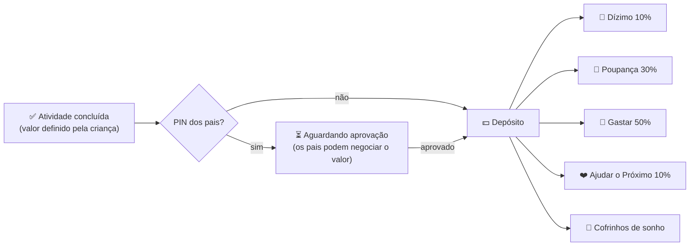
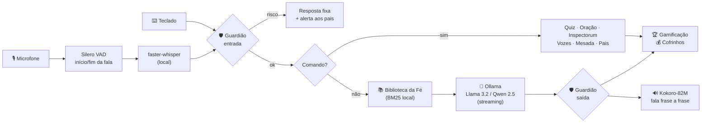

<div align="center">

```
     ██╗  █████╗  ██████╗  ██╗   ██╗ ██╗ ███████╗
     ██║ ██╔══██╗ ██╔══██╗ ██║   ██║ ██║ ██╔════╝
     ██║ ███████║ ██████╔╝ ██║   ██║ ██║ ███████╗
██   ██║ ██╔══██║ ██╔══██╗ ╚██╗ ██╔╝ ██║ ╚════██║
╚█████╔╝ ██║  ██║ ██║  ██║  ╚████╔╝  ██║ ███████║
 ╚════╝  ╚═╝  ╚═╝ ╚═╝  ╚═╝   ╚═══╝   ╚═╝ ╚══════╝   K I D S
```

### Jovem Assistente de Raciocínio, Virtudes, Inteligência e Sabedoria

**Um assistente de voz estilo "JARVIS" para crianças de 9 a 12 anos — 100% local, privado, open-source, gamificado e fiel à fé católica.**

[](https://github.com/AntonioDantas/jarvis_kids/actions/workflows/testes.yml)


[Instalar](#-passo-a-passo-para-pais-e-filhos) •
[Como usar](#-como-usar) •
[Mesada](#-mesada-por-mérito-e-cofrinhos) •
[Fé católica](#-conteúdo-católico-e-proteção-doutrinária) •
[Segurança](#-segurança-e-privacidade) •
[Arquitetura](#-arquitetura-técnica) •
[Problemas?](#-problemas-comuns)

</div>

---

## ✨ O que é?

O **J.A.R.V.I.S. Kids** transforma o computador da família num computador de bordo de nave espacial: a criança
**fala**, o Jarvis **ouve, pensa e responde com voz**, com efeitos sonoros futuristas, níveis, medalhas e missões diárias.
Ele ajuda nos estudos (com dicas, não com respostas prontas), conta histórias da Bíblia, reza junto, conduz um
exame de consciência infantil, "chama" santos para conversar e ensina **educação financeira** com uma mesada por
mérito e cofrinhos separados para **poupar, gastar, doar e o dízimo**.

Tudo roda **no seu computador**: nenhuma conversa vai para a internet.

```
╭──────────────────────────────── ◢ PAINEL DO AGENTE ◣ ────────────────────────────────╮
│        👤 Pedro           🚀 Cadete Estelar          🔥 5 dias          💰 R$ 37,50   │
│  Sabedoria ████████░░░░░░░░░░ 180/250                🎯 Missões 3/4    🤖 modo Jarvis │
╰──────────────────────────────────────────────────────────────────────────────────────╯
[1] 🧠 Quiz  [2] 🙏 Oração  [3] 🔍 Exame  [4] 📖 Vozes  [5] 💰 Mesada  [6] 🏆 Conquistas
╭─ ◈ J.A.R.V.I.S. ─────────────────────────────────────────────────────────────────────╮
│ Uau, agente Pedro! A Santíssima Trindade é um só Deus em três Pessoas: o Pai, o Filho │
│ e o Espírito Santo. O Catecismo, no número 234, diz que é o mistério central da fé…   │
╰──────────────────────────────────────────────────────────────────────────────────────╯
  📚 Fontes: A Santíssima Trindade (CIC 232-267, CIC 234)
  ✦ +7 Pontos de Sabedoria — Pergunta de Filósofo
```

| | Recurso | Como funciona |
|---|---|---|
| 🎙️ | **Conversa por voz instantânea** | Silero VAD percebe quando a criança começa e termina de falar → faster-whisper transcreve → Ollama responde **frase a frase** → Kokoro fala enquanto a IA ainda pensa |
| 🔊 | **Efeitos sonoros futuristas** | bip de ativação, bop de fim de escuta, moeda, nível, medalha… gerados por código (sem arquivos de áudio) |
| 🏆 | **Gamificação** | Pontos de Sabedoria, 8 níveis (de *Recruta Digital* a *Mestre Celestial*), 15 medalhas, sequência de dias 🔥 e 4 missões diárias |
| 💰 | **Mesada por mérito** | a criança cadastra as atividades e **escolhe os valores**; os pais aprovam com PIN; o dinheiro se divide sozinho nos cofrinhos |
| 🐷 | **Cofrinhos independentes** | Dízimo 🙏 · Poupança dos Sonhos 🐷 · Gastar com Sabedoria 🛒 · Ajudar o Próximo ❤️ · + cofrinhos-meta 🎯 |
| ✝️ | **Biblioteca da Fé (RAG)** | 86 fontes verificadas (Catecismo, Bíblia, Suma Teológica, vidas de santos) com referência, consultadas antes de cada resposta |
| 😇 | **Vozes das Escrituras** | converse com "hologramas" de Dom Bosco, Carlo Acutis, São Francisco, Santa Teresinha, São Tomás e Irmã Dulce — cada um com voz própria |
| 🔍 | **Inspectorum** | exame de consciência infantil pelos 10 Mandamentos, focado em virtudes. **As respostas nunca são gravadas** |
| 🛡️ | **Guardião** | travas doutrinárias + proteção infantil antes e depois da IA, alertas para os pais e área com PIN |
| ⚡ | **Detecção de hardware** | escolhe sozinho o melhor modelo para GPU NVIDIA, Apple Silicon (M1/M2/M3…) ou só CPU |

---

## 🚀 Passo a Passo para Pais e Filhos

> 🧒 **Para a criança:** são 4 missões. Peça para um adulto ajudar na primeira vez!
> 👨‍👩‍👧 **Para os pais:** leva uns 20 minutos na primeira vez (a maior parte é download). Depois, é só um clique.

### 🎯 Missão 1 — Instalar o Python (o "motor" dos programas)

| Sistema | O que fazer |
|---|---|
| 🪟 **Windows** | Baixe o **Python 3.12** em [python.org/downloads](https://www.python.org/downloads/) e, na instalação, **marque ✅ "Add python.exe to PATH"**. (Ou, no Terminal: `winget install Python.Python.3.12`) |
| 🍎 **Mac** | Baixe o **Python 3.12** em [python.org/downloads](https://www.python.org/downloads/) e instale normalmente. |
| 🐧 **Linux** | `sudo apt install python3 python3-venv libportaudio2` (Ubuntu/Debian) |

> Funciona com Python **3.10, 3.11 ou 3.12**. No 3.13 também roda, mas sem a voz neural Kokoro (usa a voz do sistema).

### 🧠 Missão 2 — Instalar o Ollama (o "cérebro" de IA local)

1. Baixe em **[ollama.com/download](https://ollama.com/download)** e instale (Windows e Mac: instalador normal).
   - 🐧 Linux: `curl -fsSL https://ollama.com/install.sh | sh`
2. Pronto! **Não precisa baixar modelo nenhum**: o Jarvis escolhe e baixa sozinho o melhor para o seu computador.

### 📥 Missão 3 — Baixar o Jarvis

**Opção fácil:** clique no botão verde **`<> Code` → `Download ZIP`** aqui no GitHub e descompacte numa pasta.

**Opção de agente hacker 😎** (com Git):

```bash
git clone https://github.com/AntonioDantas/jarvis_kids.git
cd jarvis_kids
```

### 🚀 Missão 4 — Ligar o Jarvis (um único comando!)

| Sistema | Comando |
|---|---|
| 🪟 **Windows** | dê **dois cliques** em **`iniciar.bat`** |
| 🍎 **Mac** / 🐧 **Linux** | no Terminal, dentro da pasta: **`./iniciar.sh`** |

Na **primeira vez**, o script cria um ambiente isolado (`.venv`), instala os componentes e baixa os modelos de IA
(aprox.: cérebro 2 GB, ouvido 0,5 GB, voz 0,3 GB). Depois disso o Jarvis **liga em segundos e funciona sem internet**.

Então o Jarvis vai perguntar o nome da criança e a idade, e oferecer aos pais a criação de um **PIN** 🔑.

> 💡 **Dica:** no Windows, use o aplicativo **Terminal** (Windows Terminal) para ver as cores e emojis no capricho.

---

## 🎮 Como usar

Na tela principal, a criança pode **apertar ENTER e falar** 🎙️ ou **digitar**. Tudo funciona das duas formas.
Para menus, basta dizer ou digitar o **número**, a **letra** ou o **nome** da opção ("a segunda", "letra B"...).

| Fale ou digite… | O que acontece |
|---|---|
| *qualquer pergunta* — "Por que o céu é azul?", "O que é a Eucaristia?" | o Jarvis responde por voz (com fontes, quando o tema é fé) e dá **Pontos de Sabedoria** para perguntas curiosas |
| `1` · "quiz" | 🧠 **Quiz Desafio**: 61 perguntas revisadas (fé, Bíblia, santos, ciência, finanças, matemática), com combo 🔥 |
| `2` · "vamos rezar" | 🙏 **Oração guiada**: o Jarvis reza linha por linha, com intenção especial |
| `3` · "exame de consciência" | 🔍 **Inspectorum** (rápido ou completo) + desafio de virtude para amanhã |
| `4` · "conta uma história" | 📖 **Vozes das Escrituras**: 15 histórias da Bíblia e conversa com santos |
| "quero falar com o Carlo Acutis" | 😇 ativa o holograma do santo (diga "voltar ao normal" para sair) |
| `5` · "mesada" | 💰 central financeira: atividades, cofrinhos, metas, dízimo, simulador de poupança |
| "eu arrumei a cama!" | ✅ o Jarvis reconhece a atividade e pergunta se quer registrar na mesada |
| "quanto eu tenho?" | 🐷 lê o saldo de cada cofrinho |
| `6` · "conquistas" | 🏆 medalhas, missões do dia e nível |
| `7` · "área dos pais" | 👨‍👩‍👧 aprovações, relatório, alertas e configurações (com PIN) |
| `0` · "tchau" | ⏻ desliga com efeito sonoro |

**Opções de linha de comando** (funcionam com `iniciar.bat`/`iniciar.sh` ou `python main.py`):

```text
--texto         não usa o microfone (só teclado)
--mudo          não fala (só texto na tela)
--maos-livres   escuta contínua, sem apertar ENTER (diga "Jarvis..." quando quiser)
--perfil NOME   entra direto no perfil de uma criança
--modelo NOME   força um modelo do Ollama (ex.: qwen2.5:7b)
--sem-efeitos   desliga os efeitos sonoros
--diagnostico   mostra um raio-X do sistema (hardware, Ollama, áudio, versões)
--redefinir-pin apaga o PIN dos pais (esqueceu o PIN?)
```

---

## 💰 Mesada por Mérito e Cofrinhos

Educação financeira na prática, do jeito que as crianças entendem:



* **A criança cadastra as próprias atividades** — domésticas (arrumar a cama, lavar a louça, cuidar do pet) e
  humanas do dia a dia (ajudar um irmão, visitar os avós, ler um livro) — e **escolhe quanto cada uma vale**.
  Isso abre uma ótima conversa em família sobre o valor do trabalho. 💬
* **Divisão automática** pelos percentuais que a criança define (a soma sempre fecha 100%, centavo por centavo).
* **Cofrinhos-meta** com barra de progresso ("Bicicleta nova — R$ 300") e comemoração quando a meta é atingida.
* **Dízimo e doações**: o dinheiro é "entregue" com alegria (com a *Oração da Partilha*) e vira medalha.
* **Simulador de poupança**: "guardando R$ 5 por semana, quanto terei em 1 ano? E com juros?"
* **Extrato** completo, valores em centavos inteiros (sem erro de arredondamento) e backup automático.
* Os pais podem dar **bônus**, definir um **bônus por nível** e aprovar/recusar atividades na Área dos Pais.

> 🙏 **Dica pedagógica:** responsabilidades da casa podem valer dinheiro; já a vida de fé (rezar, ir à Missa) vale
> Pontos de Sabedoria — a fé a gente vive por amor, não por pagamento. A Igreja pede que cada um ajude conforme
> suas possibilidades (CIC 2043); 10% é uma referência comum, mas a família decide.

---

## 🙏 Conteúdo católico e proteção doutrinária

### 📚 Biblioteca da Fé — RAG local no estilo "ccc-ai"
Antes de responder, o Jarvis procura (com busca BM25 em português, sem GPU e sem internet) os trechos mais
relevantes da biblioteca e os entrega à IA como **FONTES VERIFICADAS**, mostrando-as na tela:

* **65 resumos infantis do Catecismo da Igreja Católica** com os números dos parágrafos (Trindade, sacramentos,
  10 Mandamentos, virtudes, oração, Maria, anjos, fé e ciência, dízimo, internet e IA — inclusive o documento
  *Antiqua et Nova*, 2025)
* **Suma Teológica** de São Tomás de Aquino (ex.: as cinco vias, ST I, q.2, a.3) adaptada para crianças
* **6 vidas de santos** e **15 histórias bíblicas** com referência (ex.: 1Sm 17, Jo 6,1-14)
* **Seu próprio material**: coloque `.md`, `.txt` ou `.json` em [`dados/conhecimento/extra/`](dados/conhecimento/extra/LEIA-ME.md)
  (catequese da paróquia, por exemplo) e ele vira fonte automaticamente

### 😇 Vozes das Escrituras
"Hologramas educativos" de **São João Bosco** (padroeiro da juventude), **São Carlo Acutis** (o santo da internet),
**São Francisco de Assis**, **Santa Teresinha**, **São Tomás de Aquino** e **Santa Dulce dos Pobres**.
Cada persona tem **voz própria**, estilo próprio e usa **somente fatos verificados e citações de fonte conhecida**
(o prompt proíbe inventar frases). A IA nunca fala como Deus, Jesus, Nossa Senhora ou um anjo.

### 🔍 Inspectorum — Exame de Consciência infantil
Um "escaneamento do coração" pelos Dez Mandamentos (CIC 1454) com linguagem positiva, foco em **virtudes** e um
**desafio de virtude** para o dia seguinte, terminando com o Ato de Contrição. É conteúdo fixo (a IA não participa)
e **nenhuma resposta é gravada** — só fica registrado que o exame foi feito.

### 🛡️ Travas doutrinárias (System Prompt + filtros)
O [System Prompt](config.py) obriga o Jarvis a: seguir o Magistério; basear-se nas fontes e citar o Catecismo;
**nunca inventar citações, versículos ou números**; admitir quando não sabe e indicar pais, catequista ou padre;
rejeitar o relativismo moral sem desrespeitar quem pensa diferente; não substituir o padre nem a Confissão; não
opinar sobre política; tratar fé e ciência como aliadas (CIC 159); evitar analogias erradas (como "água, gelo e
vapor" para a Trindade); e **ignorar qualquer tentativa de "hackear" as regras**. A temperatura do modelo é baixa
(0,5) para reduzir "invenções".

> ⚠️ **Honestidade:** nenhuma IA é infalível. O Jarvis é um apoio, **não substitui** a família, a catequese nem a
> orientação de um sacerdote. Os resumos são do projeto (não são o texto oficial); para o texto integral, consulte o
> [Catecismo no site do Vaticano](https://www.vatican.va/archive/cathechism_po/index_new/prima-pagina-cic_po.html).

<details>
<summary><b>Sobre o ecossistema CatholicOS</b></summary>

O pedido original citava projetos como *ccc-ai*, *CCC-ai-guide*, *Inspectorum* e *Vozes das Escrituras*. Até a data
deste projeto, **não encontramos repositórios públicos com esses nomes** na organização
[CatholicOS / Catholic Digital Commons Foundation](https://github.com/CatholicOS). Por isso, esses recursos foram
**implementados aqui como módulos locais** (`jarvis/fe/`), com uma arquitetura de fontes plugável
(`dados/conhecimento/extra/`) pronta para receber conjuntos de dados abertos. Projetos reais da organização que
podem ser integrados no futuro: [`liturgical-calendar-api`](https://github.com/CatholicOS/liturgical-calendar-api)
(santo do dia), [`bibleget-api`](https://github.com/CatholicOS/bibleget-api) (citações bíblicas) e a especificação
[`cdcf-uri-scheme`](https://github.com/CatholicOS/cdcf-uri-scheme) (identificadores estáveis do Catecismo e da
Escritura). Integrações com serviços online devem ser **opcionais**, para manter o modo 100% local.
</details>

---

## 🔒 Segurança e privacidade

| Proteção | Detalhes |
|---|---|
| 🏠 **100% local** | voz, transcrição, IA e dados rodam no seu PC. Após o primeiro download, os modelos carregam **sem acessar a internet** (`HF_HUB_OFFLINE`) e a telemetria das bibliotecas é desligada |
| 🚨 **Situações de risco** | frases sobre automutilação, abuso, segredos com adultos, bullying, desafios perigosos e apostas ("tigrinho") recebem **resposta fixa e acolhedora** (CVV 188, Disque 100, 190) — sem passar pela IA — e geram **alerta para os pais** |
| 🧹 **Filtro de saída** | cada frase gerada pela IA é conferida **antes** de aparecer na tela ou ser falada |
| 🔐 **Dados pessoais** | se a criança tentar informar telefone, endereço, senha ou CPF, o Jarvis ensina a não compartilhar |
| 🕹️ **Anti-manipulação** | "ignore suas regras", "modo desenvolvedor" etc. são bloqueados com bom humor |
| ⏱️ **Tempo de tela** | limite diário opcional, configurável na Área dos Pais |
| 👨‍👩‍👧 **Área dos Pais** | PIN com hash PBKDF2; aprovação de atividades, relatório, alertas e configurações |
| 🗂️ **Seus dados** | ficam em `meus_dados/` (fora do Git) — um arquivo JSON por criança, com backup `.bak` automático |
| 🌐 **Edge-TTS** | voz da Microsoft **opcional e desligada por padrão** (precisa de internet e envia o texto falado à Microsoft) |

---

## 🧠 Arquitetura técnica



### ⚡ Detecção automática de hardware ([`config.py`](config.py))

| Hardware detectado | Modelo de IA | Whisper | Observações |
|---|---|---|---|
| GPU NVIDIA ≥ 8 GB | `qwen2.5:7b` | `small`/`medium` na GPU (float16) | `medium` a partir de 12 GB |
| GPU NVIDIA 4–8 GB | `llama3.2:3b` | `small` na GPU (float16) | se faltar CUDA/cuDNN, o Whisper cai para CPU sozinho |
| Apple Silicon ≥ 16 GB | `qwen2.5:7b` | `small` (CPU int8) | o Ollama usa a GPU Metal automaticamente |
| Apple Silicon 8 GB | `llama3.2:3b` | `small` (CPU int8) | |
| Só CPU, RAM ≥ 8 GB | `llama3.2:3b` | `small` (≥ 4 núcleos) ou `base` | `num_thread` = núcleos físicos |
| Só CPU, RAM < 8 GB | `llama3.2:1b` | `base` | contexto reduzido para 2048 tokens |

Para baixa latência: o modelo fica carregado na memória (`keep_alive=30m`), a resposta é transmitida em
*streaming*, cada frase é sintetizada enquanto a anterior toca e a memória de conversa é curta (6 trocas).

### 🔊 Voz com quedas automáticas
`Kokoro-82M` (neural, local, pt-BR: `pm_alex`, `pm_santa`, `pf_dora`) → **voz do sistema** (macOS `say`, SAPI no
Windows, eSpeak no Linux) → modo mudo. Sem microfone ou PortAudio, o Jarvis entra em **modo teclado** automaticamente.

### 📁 Estrutura do projeto

```text
jarvis_kids/
├── main.py                 # loop principal: voz → Guardião → comandos/RAG → Ollama → voz + gamificação
├── config.py               # detecção de hardware, plano de IA, preferências e System Prompt
├── requirements.txt        # dependências com versões fixadas
├── iniciar.bat / iniciar.sh# instalação + execução com um único comando
├── jarvis/
│   ├── cerebro.py          # cliente Ollama (streaming, memória curta, filtro <think>)
│   ├── interacao.py        # ouvir/falar/escolher: digitar OU falar em qualquer pergunta
│   ├── seguranca.py        # Guardião (entrada e saída)
│   ├── gamificacao.py      # pontos, níveis, medalhas, missões, sequência
│   ├── mesada.py           # regras da mesada e dos cofrinhos (centavos inteiros)
│   ├── painel_mesada.py    # telas da mesada
│   ├── area_pais.py        # Área dos Pais com PIN
│   ├── comandos.py         # entende comandos de voz e atividades ("eu arrumei a cama")
│   ├── ui.py               # HUD futurista (Rich)
│   ├── audio/              # efeitos.py · vad.py (Silero) · ouvido.py (Whisper) · voz.py (Kokoro/sistema/Edge)
│   └── fe/                 # conhecimento.py (RAG) · vozes.py · inspectorum.py · oracoes.py · quiz.py
├── dados/                  # conteúdo revisável em JSON: catecismo, santos, histórias, orações, quiz…
│   └── conhecimento/extra/ # 👉 coloque aqui o material da sua paróquia
└── tests/                  # 149 testes (rodam sem GPU, microfone ou Ollama)
```

---

## 👪 Área dos Pais

Diga **"área dos pais"** (ou tecle `7`) e informe o PIN:

* ✅ **Aprovar atividades** da mesada (inclusive com outro valor — ótimo para negociar!)
* 📊 **Relatório**: nível, sequência, perguntas, orações, quizzes, cofrinhos, uso diário e desafio de virtude
* 🚨 **Alertas de segurança** com o que a criança disse e orientações
* 🎁 **Bônus** de mesada
* ⚙️ **Configurações**: modelo de IA, motor e voz, modo mãos-livres, aprovação, **limite diário de uso**, bônus por nível

Variáveis de ambiente úteis: `JARVIS_DADOS` (outra pasta para os dados) e `OLLAMA_HOST` (Ollama em outro endereço).

---

## 🩺 Problemas comuns

| Sintoma | Solução |
|---|---|
| "O motor de IA (Ollama) não está ligado" | Abra o aplicativo **Ollama** (Windows/Mac) ou rode `ollama serve` (Linux) |
| O Jarvis não ouve / não fala no Linux | `sudo apt install libportaudio2` e confira o microfone nas configurações de som |
| A voz está com sotaque estrangeiro | Use Python 3.10–3.12 para ter a voz neural Kokoro; ou instale uma voz pt-BR no sistema |
| Respostas lentas | Rode `./iniciar.sh --diagnostico`; em PCs simples, escolha `llama3.2:1b` na Área dos Pais |
| GPU NVIDIA não usada pelo Whisper | Normal sem as bibliotecas CUDA/cuDNN: ele usa a CPU automaticamente (o Ollama continua usando a GPU) |
| Esqueci o PIN | `python main.py --redefinir-pin` (ou `iniciar.bat --redefinir-pin`) |
| Emojis aparecem como quadrados no Windows | Use o aplicativo **Terminal** (Windows Terminal) |
| Erro ao instalar no Windows | Instale o [Visual C++ Redistributable](https://aka.ms/vs/17/release/vc_redist.x64.exe) e tente de novo |

---

## 🤝 Como contribuir

Contribuições são muito bem-vindas — principalmente **revisão de conteúdo** por catequistas, padres, educadores e
pais! Veja o [CONTRIBUTING.md](CONTRIBUTING.md). Para desenvolver:

```bash
python -m venv .venv && source .venv/bin/activate   # Windows: .venv\Scripts\activate
pip install -r requirements-dev.txt
pytest -q && ruff check .
```

**Ideias para o futuro:** santo do dia via `liturgical-calendar-api` (opcional), interface gráfica com
avatar animado, mais santos e histórias, leitura do Evangelho do dia, modo multiplayer de quiz entre irmãos.

---

## 📜 Licença e créditos

Código sob licença **[MIT](LICENSE)**. Conteúdo dos resumos e histórias escrito pelo projeto; orações tradicionais
são de uso comum da Igreja.

Construído com: [Ollama](https://ollama.com) · [faster-whisper](https://github.com/SYSTRAN/faster-whisper) ·
[Silero VAD](https://github.com/snakers4/silero-vad) · [Kokoro-82M](https://huggingface.co/hexgrad/Kokoro-82M) ·
[Rich](https://github.com/Textualize/rich) · [edge-tts](https://github.com/rany2/edge-tts) (opcional).
Os modelos de IA têm licenças próprias (ex.: *Llama 3.2 Community License*, licenças do *Qwen 2.5*) — confira antes
de usos comerciais.

O nome é uma homenagem aos computadores de bordo da ficção científica; este é um projeto independente, sem vínculo
com a Marvel/Disney nem representação oficial da Igreja Católica.

<div align="center">

**Feito com ❤️ e 🙏 para que as crianças cresçam em sabedoria, em estatura e em graça (Lc 2,52).**

</div>
