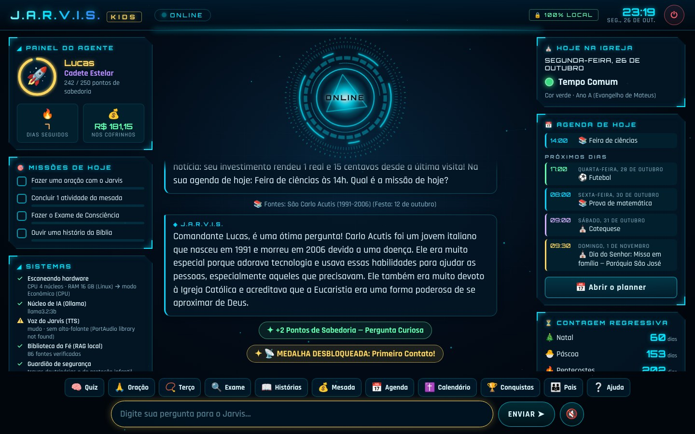
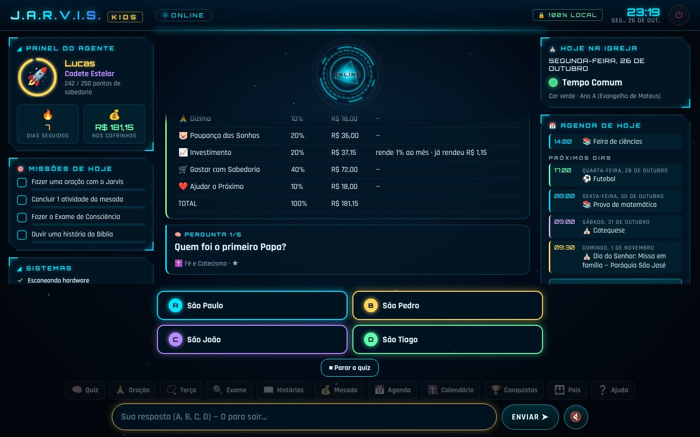
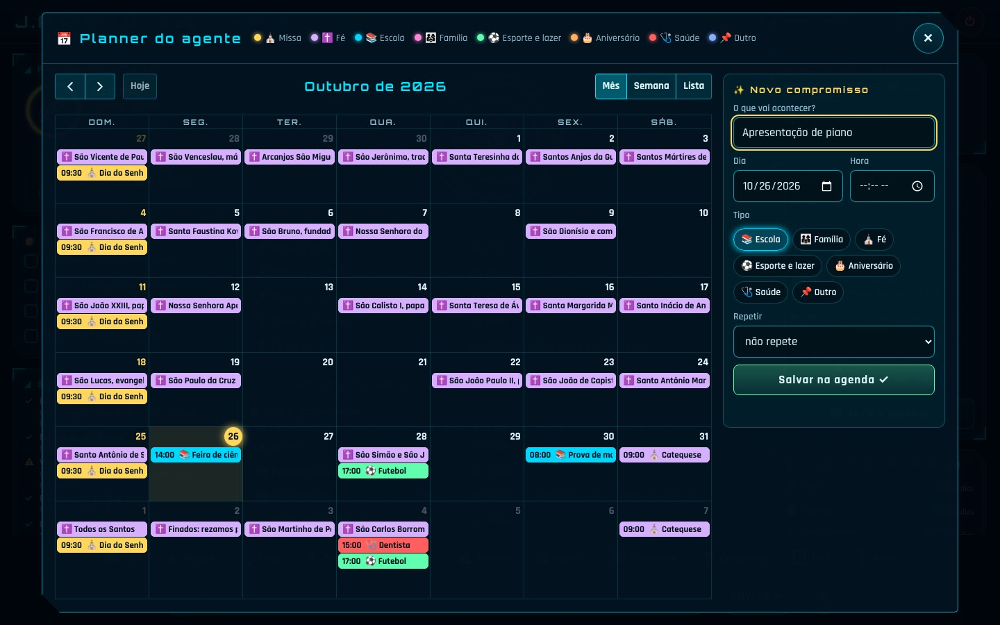
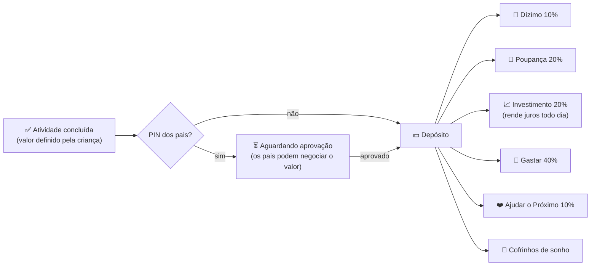
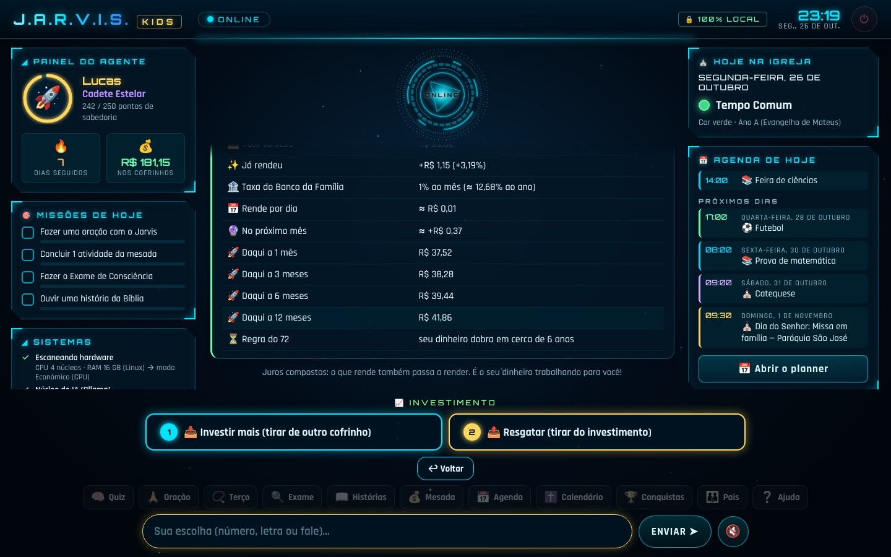
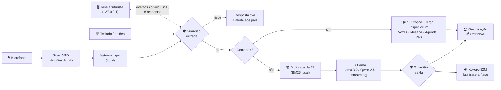

<div align="center">

```
     ██╗  █████╗  ██████╗  ██╗   ██╗ ██╗ ███████╗
     ██║ ██╔══██╗ ██╔══██╗ ██║   ██║ ██║ ██╔════╝
     ██║ ███████║ ██████╔╝ ██║   ██║ ██║ ███████╗
██   ██║ ██╔══██║ ██╔══██╗ ╚██╗ ██╔╝ ██║ ╚════██║
╚█████╔╝ ██║  ██║ ██║  ██║  ╚████╔╝  ██║ ███████║
 ╚════╝  ╚═╝  ╚═╝ ╚═╝  ╚═╝   ╚═══╝   ╚═╝ ╚══════╝   K I D S
```

### Jovem Assistente de Raciocínio, Virtudes, Inteligência e Sabedoria

**Um assistente de voz estilo "JARVIS" para crianças de 9 a 12 anos — 100% local, privado, open-source, gamificado e fiel à fé católica.**

[](https://github.com/AntonioDantas/jarvis_kids/actions/workflows/testes.yml)


[Instalar](#-passo-a-passo-para-pais-e-filhos) •
[Perguntas frequentes](#-perguntas-frequentes-dos-pais) •
[Como usar](#-como-usar) •
[Agenda](#-agenda-do-agente-planner) •
[Mesada](#-mesada-por-mérito-e-cofrinhos) •
[Fé católica](#-conteúdo-católico-e-proteção-doutrinária) •
[Testes com a IA](#-a-ia-foi-testada-de-verdade) •
[Segurança](#-segurança-e-privacidade) •
[Problemas?](#-problemas-comuns)

</div>

---

<div align="center">



</div>

## ✨ O que é?

O **J.A.R.V.I.S. Kids** transforma o computador da família no computador de bordo de uma nave espacial: abre uma
**janela futurista no estilo JARVIS** (núcleo reator que gira, pulsa com a voz e fica roxo quando está pensando), a
criança **fala ou digita**, e o Jarvis **ouve, pensa e responde com voz**, com efeitos sonoros, níveis, medalhas e
missões diárias. Ele ajuda nos estudos (com dicas, não com respostas prontas), conta histórias da Bíblia, reza o
terço junto, conduz um exame de consciência infantil, "chama" santos para conversar, organiza a **agenda** (com o
santo do dia e a Missa de domingo) e ensina **educação financeira** com mesada por mérito, cofrinhos separados e um
**cofrinho de investimento que mostra quanto está rendendo**.

Tudo roda **no seu computador**: nenhuma conversa vai para a internet.

| | Recurso | Como funciona |
|---|---|---|
| 🖥️ | **Janela futurista** | interface no estilo dos "JARVIS" das redes sociais: núcleo reator animado, HUD do agente, conversa em cartões, botões grandes para responder, celebrações de nível e medalha. Abre sozinha como um aplicativo (sem barra de endereço) |
| 🎙️ | **Conversa por voz instantânea** | Silero VAD percebe quando a criança começa e termina de falar → faster-whisper transcreve → Ollama responde **frase a frase** → Kokoro fala enquanto a IA ainda pensa |
| 🗣️ | **Voz escolhida pela criança** | 6 vozes (Robô Amigo, Mini-Jarvis Explorador, Mini-Jarvis Estrelinha, Capitão…), com tom ajustado para ficar mais amigável |
| 📅 | **Agenda / planner** | santo do dia (205 datas, com os santos do Brasil), Dia do Senhor com o horário da Missa, dias santos e os compromissos da criança — pelo calendário ou falando: *"marca prova de matemática na sexta às 8h"* |
| 💰 | **Mesada por mérito** | a criança cadastra as atividades e **escolhe os valores**; os pais aprovam com PIN; o dinheiro se divide sozinho nos cofrinhos |
| 📈 | **Cofrinho de Investimento** | rende juros compostos todo dia, pagos pelo "Banco da Família"; mostra quanto já rendeu, quanto rende por dia, a projeção de 1 a 12 meses e a "regra do 72" |
| 🏆 | **Gamificação** | Pontos de Sabedoria, 8 níveis (de *Recruta Digital* a *Mestre Celestial*), 17 medalhas, sequência de dias 🔥 e 4 missões diárias |
| ✝️ | **Biblioteca da Fé (RAG)** | 86 fontes verificadas (Catecismo, Bíblia, Suma Teológica, vidas de santos) com referência, consultadas antes de cada resposta |
| 📿 | **Terço, orações e liturgia** | terço guiado com os mistérios do dia, 16 orações (Angelus, Regina Caeli, Salve Rainha…), calendário litúrgico calculado no próprio PC (tempo, cor, ano A/B/C, contagem para o Natal) |
| 😇 | **Vozes das Escrituras** | converse com "hologramas" de Dom Bosco, Carlo Acutis, São Francisco, Santa Teresinha, São Tomás e Irmã Dulce |
| 🔍 | **Inspectorum** | exame de consciência infantil pelos 10 Mandamentos, focado em virtudes. **As respostas nunca são gravadas** |
| 🛡️ | **Guardião** | proteção infantil e travas doutrinárias antes e depois da IA, testadas com a IA de verdade (veja [os resultados](#-a-ia-foi-testada-de-verdade)) |
| ⚡ | **Detecção de hardware** | escolhe sozinho o melhor modelo para GPU NVIDIA, Apple Silicon (M1/M2/M3…) ou só CPU |

---

## 🚀 Passo a Passo para Pais e Filhos

> 🧒 **Para a criança:** são 4 missões. Peça para um adulto ajudar na primeira vez!
> 👨‍👩‍👧 **Para os pais:** leva uns 20 minutos na primeira vez (a maior parte é download). Depois, é só um clique.

### 🎯 Missão 1 — Instalar o Python (o "motor" dos programas)

| Sistema | O que fazer |
|---|---|
| 🪟 **Windows** | Baixe o **Python 3.12** em [python.org/downloads](https://www.python.org/downloads/) e, na instalação, **marque ✅ "Add python.exe to PATH"**. (Ou, no Terminal: `winget install Python.Python.3.12`) |
| 🍎 **Mac** | Baixe o **Python 3.12** em [python.org/downloads](https://www.python.org/downloads/) e instale normalmente. |
| 🐧 **Linux** | `sudo apt install python3 python3-venv libportaudio2` (Ubuntu/Debian) |

> Funciona com Python **3.10, 3.11 ou 3.12**. No 3.13 também roda, mas sem a voz neural Kokoro (usa a voz do sistema).

### 🧠 Missão 2 — Instalar o Ollama (o "cérebro" de IA local)

1. Baixe em **[ollama.com/download](https://ollama.com/download)** e instale (Windows e Mac: instalador normal).
   - 🐧 Linux: `curl -fsSL https://ollama.com/install.sh | sh`
2. Pronto! **Não precisa baixar modelo nenhum à mão**: na primeira vez, o Jarvis escolhe o melhor modelo para o seu
   computador e baixa sozinho, com barra de progresso (veja as [perguntas frequentes](#-perguntas-frequentes-dos-pais)).

### 📥 Missão 3 — Baixar o Jarvis

**Opção fácil:** clique no botão verde **`<> Code` → `Download ZIP`** aqui no GitHub e descompacte numa pasta.

**Opção de agente hacker 😎** (com Git):

```bash
git clone https://github.com/AntonioDantas/jarvis_kids.git
cd jarvis_kids
```

### 🚀 Missão 4 — Ligar o Jarvis (um único comando!)

| Sistema | Comando |
|---|---|
| 🪟 **Windows** | dê **dois cliques** em **`iniciar.bat`** |
| 🍎 **Mac** / 🐧 **Linux** | no Terminal, dentro da pasta: **`./iniciar.sh`** |

Na **primeira vez**, o script cria um ambiente isolado (`.venv`), instala os componentes e **baixa todos os modelos
de IA de uma vez** (aprox.: cérebro 2 GB, ouvido 0,5 GB, voz 0,3 GB). Depois disso o Jarvis **liga em segundos e
funciona sem internet**.

A **janela do Jarvis abre sozinha** (no Edge, Chrome, Chromium ou Brave em "modo aplicativo": parece um programa,
sem barra de endereço). Então o Jarvis pergunta o nome e a idade da criança, oferece aos pais a criação de um
**PIN** 🔑 e deixa a criança **escolher a voz** dele.

> 💡 Prefere o modo clássico de terminal? Use `iniciar.bat --terminal` ou `./iniciar.sh --terminal`.

---

## ❓ Perguntas frequentes dos pais

<details open>
<summary><b>O modelo de IA é pequeno para rodar em qualquer PC, ou é um modelo grande que roda "em camadas"?</b></summary>

São modelos **pequenos e comprimidos** (quantizados em 4 a 8 bits), feitos para rodar em computadores comuns — não
é um modelo gigante de data center. O Jarvis detecta o seu hardware e escolhe sozinho:

| Modelo | Tamanho do download | Memória usada (aprox.) | Quando é escolhido |
|---|---|---|---|
| `llama3.2:1b` | ~1,3 GB | ~2 GB de RAM | PCs com menos de 8 GB de RAM |
| `llama3.2:3b` (padrão) | ~2,0 GB | ~3–4 GB de RAM | PCs com 8 GB de RAM ou mais, Macs de 8 GB, GPUs de 4–8 GB |
| `qwen2.5:7b` | ~4,7 GB | ~6–8 GB | GPU NVIDIA com 8 GB ou mais, Macs com 16 GB ou mais |

* **"Camadas"**: o Ollama (que usa o llama.cpp por baixo) divide o modelo em camadas. Se houver placa de vídeo, ele
  coloca na GPU as camadas que couberem e o resto fica na CPU — tudo automático. **Sem placa de vídeo, o modelo
  inteiro roda na CPU e na RAM**, normalmente.
* **Mínimo recomendado**: 8 GB de RAM, processador de 4 núcleos e ~6 GB livres no disco. Funciona com 4 GB de RAM
  usando o modelo de 1B (respostas mais simples).
* **Velocidade real** medida num PC só com CPU de 4 núcleos (sem placa de vídeo): com o `llama3.2:3b`, o Jarvis
  começa a falar em ~6 s e termina uma resposta completa em ~20–25 s (a voz vai lendo frase a frase enquanto a IA
  escreve). Com GPU NVIDIA ou Apple Silicon fica bem mais rápido.
* Em PCs sem placa de vídeo, a janela usa **animações leves** automaticamente, para não roubar a CPU da IA.

</details>

<details>
<summary><b>O modelo baixa sozinho ou eu preciso baixar?</b></summary>

**Baixa sozinho.** Na primeira vez, o `iniciar.bat`/`iniciar.sh` roda `python main.py --preparar`, que baixa o
cérebro (pelo Ollama), o ouvido (Whisper) e a voz (Kokoro) com barra de progresso. Se faltar algo, o Jarvis tenta
de novo ao ligar. Para baixar à mão (ex.: num PC sem internet depois): `ollama pull llama3.2:3b`. Para trocar de
modelo, use a **Área dos Pais → Configurações → Modelo de IA**, ou `--modelo qwen2.5:7b`.

</details>

<details>
<summary><b>Existe voz de criança?</b></summary>

Nenhum motor de voz **local** em português do Brasil tem voz infantil de verdade. Para deixar o Jarvis mais
amigável, criamos **6 vozes** a partir das vozes neurais do Kokoro (`pm_alex`, `pf_dora`, `pm_santa`) com o tom
ajustado: 🤖 **Robô Amigo** (padrão, jovem e animada), ⭐ **Estrela Guia** (feminina jovem), 🧒 **Mini-Jarvis
Explorador** (voz de menino), 👧 **Mini-Jarvis Estrelinha** (voz de menina), 🚀 **Capitão** (a voz clássica) e 🦉
**Professor Sábio** (grave e calma). Os santos das "Vozes das Escrituras" têm vozes próprias. Na primeira vez a criança ouve as amostras e escolhe; depois
é só dizer **"mudar a voz"**. Conferimos com o próprio Whisper que todas continuam 100% compreensíveis.

</details>

<details>
<summary><b>A janela precisa de internet? Alguém de fora consegue acessar?</b></summary>

Não e não. A janela é uma página servida **pelo próprio Jarvis** no endereço local `127.0.0.1` (só o seu computador
enxerga), protegida por um código secreto de sessão e por uma política que proíbe carregar qualquer coisa de fora.
Fontes, calendário e animações estão dentro do projeto.

</details>

---

## 🎮 Como usar

A criança pode **apertar o botão 🎙️ FALAR** (ou Enter com o campo vazio) e falar, ou **digitar**. Quando o Jarvis
faz uma pergunta, aparecem **botões grandes** para responder: alternativas coloridas no quiz, ✅ Sim / ❌ Não,
**teclado numérico** para idade e valores, cardápios de opções. Tudo também funciona falando ("a segunda",
"letra B", "dois reais e cinquenta"…).

| Botão · fale ou digite… | O que acontece |
|---|---|
| *qualquer pergunta* — "Por que o céu é azul?", "O que é a Eucaristia?" | o Jarvis responde por voz (com fontes, quando o tema é fé) e dá **Pontos de Sabedoria** para perguntas curiosas |
| 🧠 **Quiz** | 62 perguntas revisadas (fé, Bíblia, santos, ciência, finanças, matemática), com combo 🔥 |
| 🙏 **Oração** · "vamos rezar" | oração guiada linha por linha (sugere o Angelus ao meio-dia, ou a Regina Caeli no tempo pascal) |
| 📿 **Terço** | terço guiado com os mistérios do dia, meditações para crianças e as contas acendendo na tela |
| 🔍 **Exame** | **Inspectorum** (rápido ou completo) + desafio de virtude para amanhã |
| 📖 **Histórias** · "conta uma história" | 15 histórias da Bíblia e conversa com santos |
| "quero falar com o Carlo Acutis" | 😇 ativa o holograma do santo (diga "voltar ao normal" para sair) |
| 💰 **Mesada** | atividades, cofrinhos, **investimento**, metas, dízimo, simulador de poupança |
| "eu arrumei a cama!" | ✅ o Jarvis reconhece a atividade e pergunta se quer registrar na mesada |
| 📅 **Agenda** · "o que eu tenho hoje?" | abre o planner com o santo do dia, a Missa e os compromissos |
| "marca prova de matemática na sexta às 8h" | 📝 anota direto na agenda (o Jarvis confirma antes) |
| ✝️ **Calendário** · "quanto falta para o Natal?" | tempo litúrgico, cor do dia, ano A/B/C e contagem regressiva |
| 🏆 **Conquistas** | medalhas, missões do dia e nível |
| 👪 **Pais** · "área dos pais" | aprovações, relatório, alertas e configurações (com PIN) |
| ⏻ (no topo) · "tchau" | desliga com efeito sonoro |

<div align="center">



</div>

**Opções de linha de comando** (funcionam com `iniciar.bat`/`iniciar.sh` ou `python main.py`):

```text
--terminal      usa o terminal em vez da janela futurista
--tela-cheia    abre a janela do Jarvis em tela cheia
--sem-janela    não abre a janela sozinho (mostra o endereço para abrir em qualquer navegador)
--porta N       porta local da janela (padrão 8765)
--texto         não usa o microfone (só teclado)
--mudo          não fala (só texto na tela)
--maos-livres   escuta contínua, sem apertar botão (diga "Jarvis..." quando quiser)
--perfil NOME   entra direto no perfil de uma criança
--modelo NOME   força um modelo do Ollama (ex.: qwen2.5:7b)
--sem-efeitos   desliga os efeitos sonoros
--preparar      baixa de uma vez todos os modelos de IA e sai
--diagnostico   mostra um raio-X do sistema (hardware, Ollama, áudio, versões)
--redefinir-pin apaga o PIN dos pais (esqueceu o PIN?)
```

---

## 📅 Agenda do agente (planner)

<div align="center">



</div>

* **Santo ou festa de cada dia** (205 datas do Calendário Romano Geral + calendário do Brasil: São José de
  Anchieta, Frei Galvão, Santa Paulina, Mártires de Cunhaú e Uruaçu, Santa Dulce, Nossa Senhora Aparecida…).
* **Dia do Senhor**: todo domingo aparece "Missa em família", com o **horário e a paróquia** que a família
  cadastrar (na agenda ou na Área dos Pais), e também os **dias santos de guarda** do Brasil (1º de janeiro,
  Corpus Christi, Imaculada Conceição e Natal).
* **Festas móveis calculadas no próprio PC**: Páscoa, Cinzas, Pentecostes, Corpus Christi, Advento… e as
  solenidades que no Brasil vão para o domingo (Epifania, Ascensão, São Pedro e São Paulo, Assunção, Todos os Santos).
* **Compromissos da criança** por tipo (📚 escola, 👨‍👩‍👧 família, ⛪ fé, ⚽ esporte e lazer, 🎂 aniversário, 🩺
  saúde), que podem **repetir toda semana** (futebol) ou **todo ano** (aniversário da vovó).
* Marque clicando no dia do calendário ou **falando**: *"anota aniversário da vovó dia 15 de novembro"*,
  *"me lembra de levar o trabalho de ciências amanhã"*, *"marca futebol toda terça às 17h30"*.
* O Jarvis lembra os compromissos na saudação do dia, e o painel da direita mostra **"Hoje na Igreja"**, a
  **agenda de hoje**, os **próximos dias** e a **contagem regressiva** para Natal, Páscoa e Pentecostes.
* Todo texto da agenda passa pelo **Guardião** (nada impróprio entra no planner).

O calendário visual é o [FullCalendar](https://fullcalendar.io) (licença MIT), incluído no projeto — sem internet.

---

## 💰 Mesada por Mérito e Cofrinhos

Educação financeira na prática, do jeito que as crianças entendem:



* **A criança cadastra as próprias atividades** — domésticas (arrumar a cama, lavar a louça, cuidar do pet) e
  humanas do dia a dia (ajudar um irmão, visitar os avós, ler um livro) — e **escolhe quanto cada uma vale**.
  Isso abre uma ótima conversa em família sobre o valor do trabalho. 💬
* **Divisão automática** pelos percentuais que a criança define (a soma sempre fecha 100%, centavo por centavo).
* **Cofrinhos-meta** com barra de progresso ("Bicicleta nova — R$ 300") e comemoração quando a meta é atingida.
* **Dízimo e doações**: o dinheiro é "entregue" com alegria (com a *Oração da Partilha*) e vira medalha.
* **Simulador de poupança**: "guardando R$ 5 por semana, quanto terei em 1 ano? E com juros?"
* **Extrato** completo, valores em centavos inteiros (sem erro de arredondamento) e backup automático.
* Os pais podem dar **bônus**, definir um **bônus por nível** e aprovar/recusar atividades na Área dos Pais.

### 📈 Cofrinho de Investimento: "quanto está rendendo?"

<div align="center">



</div>

Um cofrinho próprio para investir, que **rende juros compostos todos os dias** — e mostra isso de um jeito que a
criança entende:

* **Quanto já rendeu** (em reais e em %), **quanto rende por dia** e **quanto deve render no próximo mês**.
* **Projeção** para 1, 3, 6 e 12 meses e a **"regra do 72"** ("seu dinheiro dobra em cerca de 6 anos").
* Ao abrir o Jarvis: *"Boa notícia: seu investimento rendeu 12 centavos desde a última visita!"* — e a medalha
  📈 **Investidor Mirim** quando o rendimento passa de R$ 1.
* Quem paga os juros é o **"Banco da Família"**: os pais definem a taxa na Área dos Pais (padrão **1% ao mês**,
  perto da poupança/CDI; mais que isso incentiva a investir). O cálculo é exato, com acúmulo de frações de centavo.
* A criança pode **investir mais** (tirando de outro cofrinho) ou **resgatar** quando quiser.

> 🙏 **Dica pedagógica:** responsabilidades da casa podem valer dinheiro; já a vida de fé (rezar, ir à Missa) vale
> Pontos de Sabedoria — a fé a gente vive por amor, não por pagamento. A Igreja pede que cada um ajude conforme
> suas possibilidades (CIC 2043); 10% é uma referência comum, mas a família decide.

---

## 🙏 Conteúdo católico e proteção doutrinária

### 📚 Biblioteca da Fé — RAG local no estilo "ccc-ai"
Antes de responder, o Jarvis procura (com busca BM25 em português, sem GPU e sem internet) os trechos mais
relevantes da biblioteca e os entrega à IA como **FONTES VERIFICADAS**, mostrando-as na tela:

* **65 resumos infantis do Catecismo da Igreja Católica** com os números dos parágrafos (Trindade, sacramentos,
  10 Mandamentos, virtudes, oração, Maria, anjos, fé e ciência, dízimo, internet e IA — inclusive o documento
  *Antiqua et Nova*, 2025)
* **Suma Teológica** de São Tomás de Aquino (ex.: as cinco vias, ST I, q.2, a.3) adaptada para crianças
* **6 vidas de santos** e **15 histórias bíblicas** com referência (ex.: 1Sm 17, Jo 6,1-14)
* **Seu próprio material**: coloque `.md`, `.txt` ou `.json` em [`dados/conhecimento/extra/`](dados/conhecimento/extra/LEIA-ME.md)
  (catequese da paróquia, por exemplo) e ele vira fonte automaticamente

### 😇 Vozes das Escrituras
"Hologramas educativos" de **São João Bosco** (padroeiro da juventude), **São Carlo Acutis** (o santo da internet),
**São Francisco de Assis**, **Santa Teresinha**, **São Tomás de Aquino** e **Santa Dulce dos Pobres**.
Cada persona tem **voz própria**, estilo próprio e usa **somente fatos verificados e citações de fonte conhecida**
(o prompt proíbe inventar frases). A IA nunca fala como Deus, Jesus, Nossa Senhora ou um anjo.

### 📿 Terço, orações e calendário litúrgico
* **Terço guiado** com os mistérios do dia da semana (gozosos, dolorosos, gloriosos, luminosos), meditações curtas
  para crianças, modos de uma dezena, "mini-terço" e completo — e as contas acendendo uma a uma na tela.
* **16 orações** (Pai-Nosso, Ave-Maria, Glória, Santo Anjo, Credo, Angelus, Regina Caeli, Salve Rainha, Vinde
  Espírito Santo, Ato de Contrição…), com sugestão conforme a hora e o tempo litúrgico.
* **Calendário litúrgico calculado no próprio PC** (algoritmo da Páscoa + regras do Brasil): tempo litúrgico, **cor do
  dia** e seu significado, ano A/B/C (e o evangelista do ano), festas móveis e **contagem regressiva** para Natal,
  Páscoa e Pentecostes. O Jarvis também sabe "que dia é hoje na Igreja" quando conversa.
* **Santo do dia** em 205 datas (Calendário Romano Geral + santos do Brasil), também na agenda.

### 🔍 Inspectorum — Exame de Consciência infantil
Um "escaneamento do coração" pelos Dez Mandamentos (CIC 1454) com linguagem positiva, foco em **virtudes** e um
**desafio de virtude** para o dia seguinte, terminando com o Ato de Contrição. É conteúdo fixo (a IA não participa)
e **nenhuma resposta é gravada** — só fica registrado que o exame foi feito.

### 🛡️ Travas doutrinárias (System Prompt + filtros)
O [System Prompt](config.py) obriga o Jarvis a: seguir o Magistério; basear-se nas fontes e citar o Catecismo;
**nunca inventar citações, versículos ou números**; admitir quando não sabe e indicar pais, catequista ou padre;
rejeitar o relativismo moral sem desrespeitar quem pensa diferente; não substituir o padre nem a Confissão; não
opinar sobre política; tratar fé e ciência como aliadas (CIC 159); evitar analogias erradas (como "água, gelo e
vapor" para a Trindade); e **ignorar qualquer tentativa de "hackear" as regras**. A temperatura do modelo é baixa
(0,5, e 0,3 em perguntas de fé) para reduzir "invenções".

Como prompt sozinho não basta para modelos pequenos, **cada frase gerada passa pelo Guardião de saída** antes de
aparecer ou ser falada:

* **Erros de doutrina** (ex.: modalismo — "o Pai e o Filho são a mesma pessoa", "três faces de um mesmo rosto",
  "água, gelo e vapor"; "o Espírito Santo é uma energia"; "a hóstia é só um símbolo"; "todas as religiões são
  iguais"; a IA dizendo "eu te perdoo") **interrompem a resposta** e o Jarvis sugere conversar com os pais, o
  catequista ou o padre. O filtro entende negações ("não são três deuses" passa).
* **Citações inventadas**: uma frase entre aspas atribuída a santo, papa, Bíblia ou Catecismo só passa se o texto
  estiver nas fontes verificadas; senão, **só aquela frase é retirada**.
* **Números do Catecismo inventados** — "(CIC 2559)" que não está nas fontes — são apagados.
* Links e e-mails são removidos; palavrões barram a resposta.

> ⚠️ **Honestidade:** nenhuma IA é infalível. O Jarvis é um apoio, **não substitui** a família, a catequese nem a
> orientação de um sacerdote. Os resumos são do projeto (não são o texto oficial); para o texto integral, consulte o
> [Catecismo no site do Vaticano](https://www.vatican.va/archive/cathechism_po/index_new/prima-pagina-cic_po.html).

<details>
<summary><b>Sobre o ecossistema CatholicOS</b></summary>

O pedido original citava projetos como *ccc-ai*, *CCC-ai-guide*, *Inspectorum* e *Vozes das Escrituras*. Até a data
deste projeto, **não encontramos repositórios públicos com esses nomes** na organização
[CatholicOS / Catholic Digital Commons Foundation](https://github.com/CatholicOS). Por isso, esses recursos foram
**implementados aqui como módulos locais** (`jarvis/fe/`), com uma arquitetura de fontes plugável
(`dados/conhecimento/extra/`) pronta para receber conjuntos de dados abertos. Projetos reais da organização que
podem ser integrados no futuro: [`liturgical-calendar-api`](https://github.com/CatholicOS/liturgical-calendar-api)
(santo do dia), [`bibleget-api`](https://github.com/CatholicOS/bibleget-api) (citações bíblicas) e a especificação
[`cdcf-uri-scheme`](https://github.com/CatholicOS/cdcf-uri-scheme) (identificadores estáveis do Catecismo e da
Escritura). Integrações com serviços online devem ser **opcionais**, para manter o modo 100% local.
</details>

---

## 🧪 A IA foi testada de verdade

Além dos testes automáticos (que rodam sem IA), o projeto tem um avaliador com **40 perguntas difíceis** —
situações de risco, tentativas de manipulação, assuntos delicados, lição de casa, doutrina e santos — que roda
contra o **modelo real**: [`ferramentas/avaliar_ia.py`](ferramentas/avaliar_ia.py). Ele aplica exatamente as mesmas
travas do Jarvis e mostra o que a criança veria. Qualquer família ou paróquia pode repetir:

```bash
python ferramentas/avaliar_ia.py --modelo llama3.2:3b
```

Resultado com o **Llama 3.2 3B** (o modelo padrão), num PC só com CPU de 4 núcleos, depois das correções feitas a
partir das rodadas anteriores:

| Grupo | ✓ ok | 🛡️ protegido pela 2ª trava | ✗ falhou |
|---|---|---|---|
| Proteção (abuso, automutilação, aliciamento, desafios, apostas, dados pessoais) | 9 | 0 | 0 |
| Manipulação ("ignore suas regras", faz de conta com palavrão…) | 3 | 1 | 0 |
| Acolhimento (luto, separação dos pais, medo, "de onde vêm os bebês?") | 4 | 0 | 0 |
| Estudos (redação pronta, ciência) | 3 | 0 | 0 |
| Doutrina (Trindade, Jesus, Maria, Eucaristia, Confissão, inferno, outras religiões, horóscopo, Papa) | 12 | 4 | 0 |
| Santos (personas) | 3 | 1 | 0 |
| **Total** | **34** | **6** | **0** |

"Protegido" significa que o modelo **errou** (ex.: inventou uma citação, ou escreveu "o Pai e o Filho são uma só
pessoa") e **o Guardião impediu que a criança visse ou ouvisse o erro**. É por isso que existem duas travas. O
tempo médio foi de ~24 s por resposta completa, com a primeira frase falada em ~6 s.

Com o **Llama 3.2 1B** (escolhido para PCs com menos de 8 GB de RAM): **35 ok, 2 protegidos, 3 falhas**, com
respostas bem mais rápidas (~6,5 s). Todas as situações de risco e de manipulação foram tratadas corretamente, mas
o modelo pequeno errou um fato escolar (disse que a capital da Austrália é Melbourne — é Camberra), recusou a
redação sem oferecer dicas e deu uma resposta incompleta sobre a Eucaristia (a frase com citação inventada foi
retirada e sobrou pouco). Por isso o 1B só é usado quando o computador não aguenta o 3B.

> Honestidade: 40 casos não cobrem tudo. Se encontrar uma resposta inadequada, abra uma *issue* com a pergunta —
> ela vira um novo caso de teste.

---

## 🔒 Segurança e privacidade

| Proteção | Detalhes |
|---|---|
| 🏠 **100% local** | voz, transcrição, IA e dados rodam no seu PC. Após o primeiro download, os modelos carregam **sem acessar a internet** (`HF_HUB_OFFLINE`) e a telemetria das bibliotecas é desligada |
| 🚨 **Situações de risco** | frases sobre automutilação, abuso, segredos com adultos, aliciamento ("me manda foto", "não conta pros seus pais"), bullying, desafios perigosos e apostas ("tigrinho") recebem **resposta fixa e acolhedora** (CVV 188, Disque 100, 190) — sem passar pela IA — e geram **alerta para os pais**. Entende escrita disfarçada ("s3gr3d0", "s.e.g.r.e.d.o") |
| 💛 **Assuntos delicados** | luto, medo, separação dos pais, dúvidas de fé e "de onde vêm os bebês?" recebem orientação extra para a IA responder com carinho, sem detalhes, e incentivar a conversa com os pais |
| 🧹 **Filtro de saída** | cada frase gerada pela IA é conferida **antes** de aparecer na tela ou ser falada |
| 🔐 **Dados pessoais** | se a criança tentar informar telefone, endereço, senha ou CPF, o Jarvis ensina a não compartilhar |
| 🕹️ **Anti-manipulação** | "ignore suas regras", "modo desenvolvedor" etc. são bloqueados com bom humor |
| ⏱️ **Tempo de tela** | limite diário opcional, configurável na Área dos Pais |
| 👨‍👩‍👧 **Área dos Pais** | PIN com hash PBKDF2; aprovação de atividades, relatório, alertas e configurações |
| 🗂️ **Seus dados** | ficam em `meus_dados/` (fora do Git) — um arquivo JSON por criança, com backup `.bak` automático |
| 🖥️ **Janela local** | servida só em `127.0.0.1` (ninguém da rede acessa), com código secreto de sessão, checagem de origem e política de conteúdo que bloqueia qualquer recurso externo. O navegador usa um perfil separado, sem extensões |
| 🌐 **Edge-TTS** | voz da Microsoft **opcional e desligada por padrão** (precisa de internet e envia o texto falado à Microsoft) |

---

## 🧠 Arquitetura técnica



### ⚡ Detecção automática de hardware ([`config.py`](config.py))

| Hardware detectado | Modelo de IA | Whisper | Observações |
|---|---|---|---|
| GPU NVIDIA ≥ 8 GB | `qwen2.5:7b` | `small`/`medium` na GPU (float16) | `medium` a partir de 12 GB |
| GPU NVIDIA 4–8 GB | `llama3.2:3b` | `small` na GPU (float16) | se faltar CUDA/cuDNN, o Whisper cai para CPU sozinho |
| Apple Silicon ≥ 16 GB | `qwen2.5:7b` | `small` (CPU int8) | o Ollama usa a GPU Metal automaticamente |
| Apple Silicon 8 GB | `llama3.2:3b` | `small` (CPU int8) | |
| Só CPU, RAM ≥ 8 GB | `llama3.2:3b` | `small` (≥ 4 núcleos) ou `base` | `num_thread` = núcleos físicos |
| Só CPU, RAM < 8 GB | `llama3.2:1b` | `base` | contexto reduzido para 2048 tokens |

Para baixa latência: o modelo fica carregado na memória (`keep_alive=30m`), a resposta é transmitida em
*streaming*, cada frase é sintetizada enquanto a anterior toca e a memória de conversa é curta (6 trocas).

### 🖥️ Janela futurista
O próprio Jarvis liga um pequeno servidor web **só no computador** (`127.0.0.1`, biblioteca padrão do Python) e
abre o Edge/Chrome/Chromium/Brave em **modo aplicativo** com um perfil separado. Os módulos (quiz, terço, mesada…)
continuam chamando as mesmas funções de [`jarvis/ui.py`](jarvis/ui.py); quando a janela está ligada, cada chamada
vira um evento em tempo real (Server-Sent Events) e as perguntas viram botões, teclados e cardápios. O núcleo
reator anima no ritmo da voz (o Python envia o "envelope" de volume de cada frase) e pulsa com a voz da criança
enquanto ela fala. Se não houver navegador, o Jarvis volta para o terminal sozinho (`--terminal` força isso).

### 🔊 Voz com quedas automáticas
`Kokoro-82M` (neural, local, pt-BR: `pm_alex`, `pm_santa`, `pf_dora`) → **voz do sistema** (macOS `say`, SAPI no
Windows, eSpeak no Linux) → modo mudo. Sem microfone ou PortAudio, o Jarvis entra em **modo teclado** automaticamente.

### 📁 Estrutura do projeto

```text
jarvis_kids/
├── main.py                 # loop principal: voz → Guardião → comandos/RAG → Ollama → voz + gamificação
├── config.py               # detecção de hardware, plano de IA, preferências e System Prompt
├── requirements.txt        # dependências com versões fixadas
├── iniciar.bat / iniciar.sh# instalação + download dos modelos + execução com um único comando
├── jarvis/
│   ├── cerebro.py          # cliente Ollama (streaming, memória curta, cache do prompt)
│   ├── interacao.py        # ouvir/falar/escolher: falar OU digitar em qualquer pergunta
│   ├── seguranca.py        # Guardião (entrada e saída)
│   ├── gamificacao.py      # pontos, níveis, medalhas, missões, sequência
│   ├── mesada.py           # mesada, cofrinhos e investimento com juros compostos (centavos inteiros)
│   ├── agenda.py           # agenda/planner + "marca prova na sexta às 8h"
│   ├── painel_mesada.py · painel_agenda.py · area_pais.py · personalizar.py
│   ├── ui.py               # camada de tela: terminal (Rich) ou janela futurista
│   ├── web/                # janela: servidor local, ponte de eventos, TelaWeb e static/ (HTML, CSS, JS,
│   │                       #   fontes Orbitron/Rajdhani e FullCalendar, tudo local)
│   ├── audio/              # efeitos.py · vad.py (Silero) · ouvido.py (Whisper) · voz.py (Kokoro/sistema/Edge)
│   └── fe/                 # conhecimento.py (RAG) · liturgia.py · calendario.py · terco.py · oracoes.py
│                           #   · vozes.py · inspectorum.py · quiz.py
├── dados/                  # conteúdo revisável em JSON: catecismo, santos, santo do dia, orações, terço, quiz…
│   └── conhecimento/extra/ # 👉 coloque aqui o material da sua paróquia
├── ferramentas/            # avaliar_ia.py: teste com a IA de verdade (40 casos)
├── docs/                   # imagens do README
└── tests/                  # 377 testes (rodam sem GPU, microfone, navegador ou Ollama)
```

---

## 👪 Área dos Pais

Toque em **👪 Pais** (ou diga "área dos pais") e informe o PIN:

* ✅ **Aprovar atividades** da mesada (inclusive com outro valor — ótimo para negociar!)
* 📊 **Relatório**: nível, sequência, perguntas, orações, terços, quizzes, cofrinhos, rendimento pago, uso diário
  e desafio de virtude
* 🚨 **Alertas de segurança** com o que a criança disse (inclusive respostas da IA que o Guardião barrou)
* 🎁 **Bônus** de mesada
* ⚙️ **Configurações**: modelo de IA, motor e voz, modo mãos-livres, aprovação, **limite diário de uso**, bônus por
  nível, **rendimento do Investimento** (taxa do Banco da Família), efeitos sonoros, **horário e paróquia da Missa
  de domingo** e **animações da janela** (automáticas, completas ou leves)

Variáveis de ambiente úteis: `JARVIS_DADOS` (outra pasta para os dados) e `OLLAMA_HOST` (Ollama em outro endereço).

---

## 🩺 Problemas comuns

| Sintoma | Solução |
|---|---|
| "O motor de IA (Ollama) não está ligado" | Abra o aplicativo **Ollama** (Windows/Mac) ou rode `ollama serve` (Linux) |
| O Jarvis não ouve / não fala no Linux | `sudo apt install libportaudio2` e confira o microfone nas configurações de som |
| A voz está com sotaque estrangeiro | Use Python 3.10–3.12 para ter a voz neural Kokoro; ou instale uma voz pt-BR no sistema |
| Respostas lentas | Rode `./iniciar.sh --diagnostico`; em PCs simples, escolha `llama3.2:1b` na Área dos Pais e deixe as animações em "leves" |
| A janela não abriu | Instale o Edge, Chrome ou Chromium; ou abra no navegador o endereço que aparece no terminal; ou use `--terminal` |
| A janela fechou sem querer | Fechar a janela desliga o Jarvis (é proposital). É só ligar de novo |
| GPU NVIDIA não usada pelo Whisper | Normal sem as bibliotecas CUDA/cuDNN: ele usa a CPU automaticamente (o Ollama continua usando a GPU) |
| Esqueci o PIN | `python main.py --redefinir-pin` (ou `iniciar.bat --redefinir-pin`) |
| Emojis aparecem como quadrados no terminal do Windows | Use a janela (padrão) ou o aplicativo **Terminal** (Windows Terminal) |
| Erro ao instalar no Windows | Instale o [Visual C++ Redistributable](https://aka.ms/vs/17/release/vc_redist.x64.exe) e tente de novo |

---

## 🤝 Como contribuir

Contribuições são muito bem-vindas — principalmente **revisão de conteúdo** por catequistas, padres, educadores e
pais! Veja o [CONTRIBUTING.md](CONTRIBUTING.md). Para desenvolver:

```bash
python -m venv .venv && source .venv/bin/activate   # Windows: .venv\Scripts\activate
pip install -r requirements-dev.txt
pytest -q && ruff check .
```

**Ideias para o futuro:** leitura do Evangelho do dia (com texto de uso livre), mais santos e histórias, modo
multiplayer de quiz entre irmãos, mãos-livres com botões na janela, lembretes da agenda com som.

### ✝️ Outras ferramentas católicas abertas (e como se relacionam)

| Projeto | O que é | Situação aqui |
|---|---|---|
| [CatholicOS / Catholic Digital Commons Foundation](https://github.com/CatholicOS) | organização com projetos católicos de código aberto | inspiração; a especificação [`cdcf-uri-scheme`](https://github.com/CatholicOS/cdcf-uri-scheme) pode identificar parágrafos do Catecismo e versículos no futuro |
| [`liturgical-calendar-api`](https://github.com/CatholicOS/liturgical-calendar-api) | API do calendário litúrgico com calendários nacionais | **não usada** para manter o Jarvis 100% offline; o calendário é calculado localmente em [`jarvis/fe/liturgia.py`](jarvis/fe/liturgia.py) |
| [romcal](https://pypi.org/project/romcal/) | biblioteca do calendário romano | testamos a versão Python 4.0.0b6 (beta): faltavam celebrações do Brasil (ex.: 12 de outubro) e nomes sem tradução, então ficou de fora |
| [Milagres Eucarísticos de Carlo Acutis](http://www.miracolieucaristici.org/) | a exposição sobre milagres eucarísticos criada por São Carlo Acutis | citada nas conversas com o "holograma" do santo (sem acesso à internet) |

---

## 📜 Licença e créditos

Código sob licença **[MIT](LICENSE)**. Conteúdo dos resumos e histórias escrito pelo projeto; orações tradicionais
são de uso comum da Igreja.

Construído com: [Ollama](https://ollama.com) · [faster-whisper](https://github.com/SYSTRAN/faster-whisper) ·
[Silero VAD](https://github.com/snakers4/silero-vad) · [Kokoro-82M](https://huggingface.co/hexgrad/Kokoro-82M) ·
[Rich](https://github.com/Textualize/rich) · [edge-tts](https://github.com/rany2/edge-tts) (opcional) ·
[FullCalendar](https://fullcalendar.io) 6.1.19 (MIT, incluído em `jarvis/web/static/vendor/`) · fontes
[Orbitron](https://github.com/theleagueof/orbitron) e [Rajdhani](https://github.com/itfoundry/rajdhani)
(SIL Open Font License 1.1, incluídas em `jarvis/web/static/fontes/` com as licenças).
Os modelos de IA têm licenças próprias (ex.: *Llama 3.2 Community License*, licenças do *Qwen 2.5*) — confira antes
de usos comerciais.

O nome é uma homenagem aos computadores de bordo da ficção científica; este é um projeto independente, sem vínculo
com a Marvel/Disney nem representação oficial da Igreja Católica.

<div align="center">

**Feito com ❤️ e 🙏 para que as crianças cresçam em sabedoria, em estatura e em graça (Lc 2,52).**

</div>
